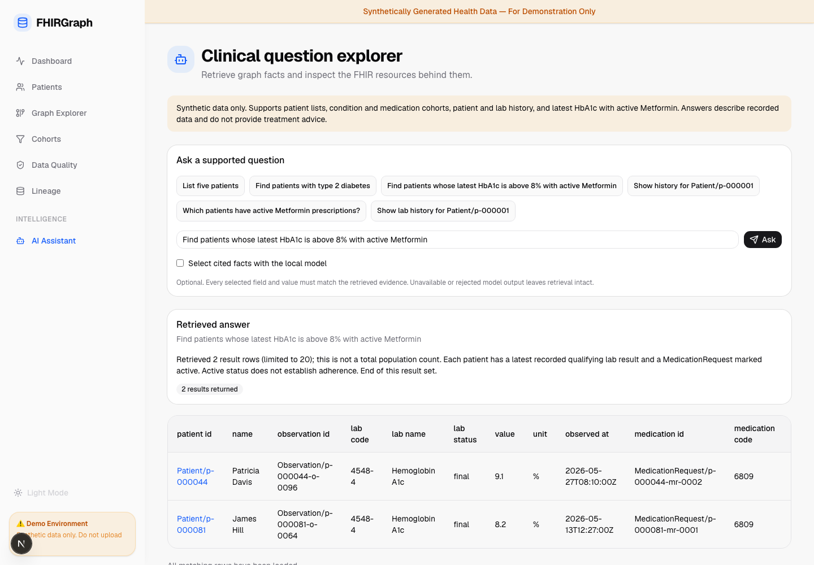

# FHIRGraph

**Mock FHIR records → a reference graph → answers with inspectable evidence.**

An end-to-end local portfolio project for healthcare data engineering and grounded graph retrieval. It generates fictional FHIR R4 records, loads three complementary stores, and lets you trace an answer to its source JSON and ingestion provenance.

[Portfolio](https://pk-999.github.io/fhir_graph_rag/) · [Case study](docs/CASE_STUDY.md) · [Walkthrough](portfolio/dist/assets/walkthrough.mp4) · [Documentation](docs/README.md)



## Run it

Requires Python 3.12+, Node.js 22+, Docker Desktop/Compose, and initial network access for dependencies and images. The default question engine needs no paid API or model.

```bash
make setup          # locked dependencies, Chromium, private local .env
make demo           # start stores/app; generate, validate, ingest, reconcile, evaluate
make verify-demo    # readiness, complete query evaluation and live browser walkthrough
```

Open [the app](http://localhost:4010) or [API docs](http://localhost:8010/docs). The default demo uses **100 patients**, seed `20260830`, and `artifacts/demo`. The public portfolio presents captured project evidence; the complete application runs locally in Docker.

For an existing checkout, changing datasets, optional Ollama, or troubleshooting, use the [run guide](docs/GETTING_STARTED.md). `make help` lists the supported commands. `make down` stops the selected stack and preserves its volumes.

## Follow one answer

Ask **“Find patients whose latest HbA1c is above 8% with active Metformin.”** The app compiles a supported plan, retrieves recorded graph facts, and offers exact FHIR source and provenance inspection. It also supports patient lists, condition/medication cohorts, and patient/lab history with bounded result pages. Unsupported filters and clinical advice abstain.

## How the repository fits together

| Path | Responsibility |
|---|---|
| [libs/synthetic](libs/synthetic) | Seeded scenarios and reproducible artifacts |
| [libs/fhir](libs/fhir) | Resource models, pinned R4 structure checks and references |
| [libs/quality](libs/quality) | Eight independent data-quality rules |
| [libs/graph](libs/graph) | Transformation, constraints and bounded Neo4j writes |
| [libs/rag](libs/rag) | Strict plans, owned queries, citations and claim validation |
| [pipelines](pipelines) | Audited generation, loading, checkpoints and reconciliation |
| [apps/api](apps/api) / [apps/web](apps/web) | FastAPI API and Next.js application |
| [scripts](scripts) | Independent evaluation, smoke checks, benchmark and recording |
| [infra](infra) / [portfolio](portfolio) | Docker stack and static portfolio presentation |

HAPI preserves original FHIR JSON, Neo4j records reference relationships, and PostgreSQL stores quality and provenance. Read the [architecture](docs/ARCHITECTURE.md), [API contract](docs/API_CONTRACT.md), or [graph schema](docs/GRAPH_SCHEMA.md) for the corresponding boundary.

## Verify the evidence

```bash
make check          # Python lint/types/tests, frontend checks/build, Compose validation
make browser-check  # controlled browser regressions
make benchmark      # isolated 1,000-patient workload and interrupted-stage recovery
```

[Current cleanup readiness](docs/evidence/readiness-2026-10-12.json): 440 Python tests, five frontend unit tests, 21 browser regressions, and the complete live pipeline/walkthrough pass.

The [October 9 release evidence](docs/evidence/portfolio-release.json) records 439 Python tests, 21 browser regressions, and 33/33 independent query cases across 79 pages with 246 distinct live FHIR sources. Its 100-patient dataset has 7,957 resources/nodes and 17,130 reference edges. The [1,000-patient report](docs/evidence/benchmark-1000.json) reconciles 80,621 nodes and 174,998 references, with all 33 cases passing across 493 pages. Dates, timings, environment and coverage are preserved in those snapshots; the [case study](docs/CASE_STUDY.md) explains the measurements.

## Project scope

This is ready for a **local mock-data demo and portfolio review**. It uses a bounded question catalog and optional local-model fact selection. Full FHIR profile/terminology conformance, unrestricted semantic search, clinical advice, authenticated public healthcare APIs and production capacity guarantees are outside its scope. Checkpoint recovery assumes the same persistent store; the [run guide](docs/GETTING_STARTED.md) explains replay and recovery.
